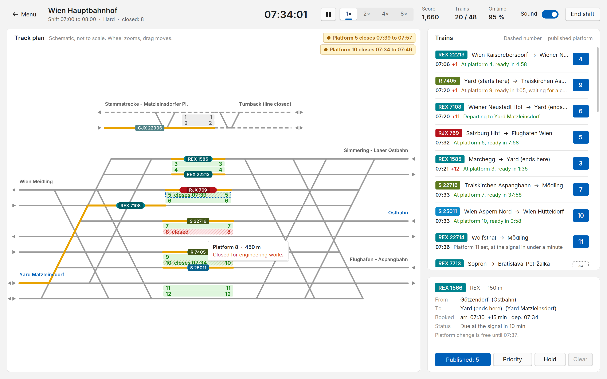
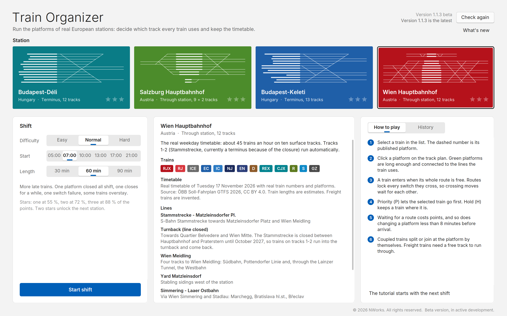
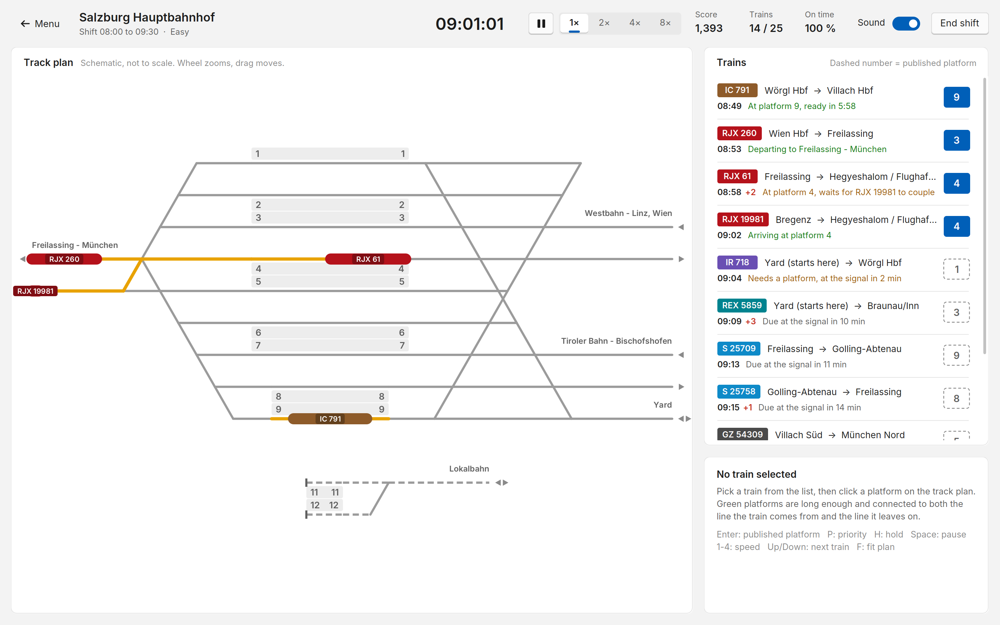

# Train Organizer

**Run the platforms of a real railway station.**

Trains are coming in from every direction. You decide which platform each one gets, who goes first
when two of them are in each other's way, and what to do when a platform closes or a switch fails.
Keep the timetable and the passengers will not even notice you were there.

> **Beta.** Train Organizer is still in beta and is actively developed by NWorks. Things can change
> between versions and you may run into bugs.

## Download

### [Download the latest version for Windows](https://github.com/User-beta/train-organizer-releases/releases/latest)

On that page, under **Assets**, click the file that ends in `.exe`.

- Works on Windows 10 and Windows 11.
- Nothing else to install. Java is included.
- About 28 MB.

## Install

1. Run the downloaded file, `TrainOrganizer-….exe`.
2. Windows may say **"Windows protected your PC"**. That appears because the installer is not yet
   signed with a paid certificate. Click **More info**, then **Run anyway**.
3. Click through the installer. You get a Start menu entry and a desktop shortcut.

Already have an older version? Just run the new installer. It replaces the old one and keeps your
progress.

## Updates

The game checks for a new version every time it starts and tells you in the top right corner of the
menu. Click **Update now** and it downloads and installs the update for you. After an update, a short
list shows what is new.

Versions 1.1.0 and 1.1.1 cannot update by themselves. If you have one of those, download the latest
installer from this page once.

## How to play

1. **Pick a station**, a difficulty and a time of day, and start your shift.
2. **Select a train** in the list on the right.
3. **Click a platform** on the track plan. Platforms shown in green can take that train.
4. The train rolls in as soon as its route is free, stops, and leaves again by itself.
5. When two trains block each other, select the one that should go first and press **Priority**.

Every train is worth 100 points. Letting a train wait costs points, and so does changing its platform
at the last minute, because the passengers have to run. Earn stars to unlock the next station. A
short tutorial explains everything during your first shift.

## The stations

| Station | What makes it special |
| --- | --- |
| **Budapest-Déli** | The place to start. Twelve tracks, but every train has to squeeze through one tunnel. |
| **Salzburg Hbf** | The real weekday timetable. Railjets are uncoupled here into two trains, and coupled again on the way back. |
| **Budapest-Keleti** | A big terminus where every train has to turn around, and all of them share one exit. |
| **Wien Hbf** | The hard one: the real weekday timetable with about 45 trains an hour. |

At Wien and Salzburg you work the real timetable of the Austrian railways, with real train numbers
and real platforms: RJX, RJ, ICE, EC, IC, Nightjet, REX, S-Bahn and more.

## Good to know

- The track plans are simplified drawings, not exact maps of the stations.
- The two Budapest stations use an approximate timetable for now.
- An iPhone version is in development.

## Problems or ideas?

Open the [Issues](https://github.com/User-beta/train-organizer-releases/issues) tab of this page and
write what happened. Please mention the version number shown in the top right corner of the menu.

## Credits and copyright

Train Organizer is © 2026 NWorks. All rights reserved. The game may not be copied, modified or
redistributed without permission.

Timetable data for Wien Hauptbahnhof and Salzburg Hauptbahnhof: ÖBB-Personenverkehr AG,
"Soll-Fahrplan GTFS 2026", [data.oebb.at](https://data.oebb.at), licensed under
[CC BY 4.0](https://creativecommons.org/licenses/by/4.0/). The data was converted and shortened for
the game. Track lengths at the Budapest stations: © OpenStreetMap contributors, ODbL.

This game is not affiliated with or endorsed by any railway company.
