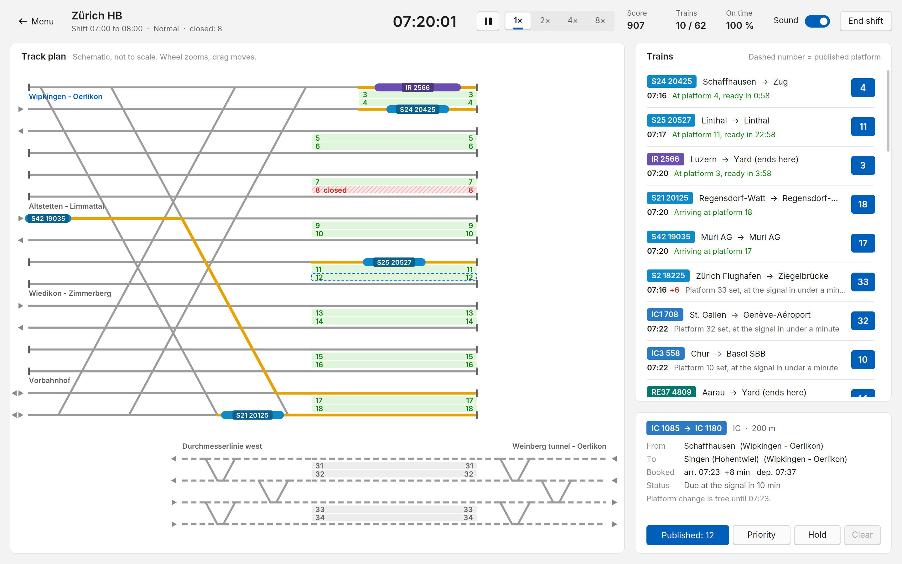

# Train Organizer

**Run the platforms of a real railway station.**

Trains are coming in from every direction. You decide which platform each one gets, who goes first
when two of them are in each other's way, and what to do when a platform closes or a switch fails.
Keep the timetable and the passengers will not even notice you were there.

> **Beta.** Train Organizer is still in beta and is actively developed by NWorks. Things can change
> between versions and you may run into bugs.


## Download

### [Download the latest version for Windows](https://github.com/User-beta/train-organizer-releases/releases/latest)

On that page, under **Assets**, click the file that ends in `.exe`.

- Works on Windows 10 and Windows 11.
- Nothing else to install. Java is included.
- About 28 MB.

### iPhone (iPhone 12 or newer, iOS 16 or newer)

The iPhone version is installed with [AltStore](https://altstore.io), which is available in the EU.

**Easiest, with automatic updates:** in AltStore open **Sources**, tap **+** and add

```
https://raw.githubusercontent.com/User-beta/train-organizer-releases/main/altstore.json
```

Then install Train Organizer from that source. AltStore will offer new versions by itself.

**Or by hand:** download the file that ends in `.ipa` from the
[latest version](https://github.com/User-beta/train-organizer-releases/releases/latest) and open it in AltStore
(My Apps, then **+**).

## Install on Windows

1. Run the downloaded file, `TrainOrganizer-….exe`.
2. Windows may say **"Windows protected your PC"**. That appears because the installer is not yet
   signed with a paid certificate. Click **More info**, then **Run anyway**.
3. Click through the installer. You get a Start menu entry and a desktop shortcut.

Already have an older version? Just run the new installer. It replaces the old one and keeps your
progress.

## Updates

The game checks for a new version every time it starts and tells you in the top right corner of the
menu. Click **Update now** and it downloads and installs the update for you. After an update, a short
list shows what is new.

Versions 1.1.0 and 1.1.1 cannot update by themselves. If you have one of those, download the latest
installer from this page once.

## How to play

1. **Pick a station**, a difficulty and a time of day, and start your shift.
2. **Select a train** in the list on the right.
3. **Click a platform** on the track plan. Platforms shown in green can take that train.
4. The train rolls in as soon as its route is free, stops, and leaves again by itself.
5. When two trains block each other, select the one that should go first and press **Priority**.

Every train is worth 100 points. Letting a train wait costs points, and so does changing its platform
at the last minute, because the passengers have to run. Every station is open from the start. Earn
up to three stars per station and collect 17 achievements. A short tutorial explains everything
during your first shift. Sounds tell you when a train needs a platform; set the volume in the menu.


## The stations

Every station runs the real timetable of Tuesday 17 November 2026.

| Station | What makes it special |
| --- | --- |
| **Budapest-Déli** | The place to start. Twelve tracks, but every train has to squeeze through one tunnel. |
| **Salzburg Hbf** | Railjets are uncoupled here into two trains, and coupled again on the way back. |
| **Budapest-Keleti** | A big terminus where every train has to turn around, and all of them share one exit. |
| **Wien Hbf** | About 45 trains an hour on ten surface tracks. |
| **Budapest-Kelenföld** | New. About 35 trains an hour crossing between four lines on ten platform tracks. |
| **Berlin Hbf** | New. All main-line trains in the eight tunnel tracks while the Stadtbahn above is closed. |
| **München Hbf** | New. 32 buffer-stop tracks in three halls and one long throat. |
| **Zürich HB** | New, and the hardest: up to 60 trains an hour on 16 terminal tracks and the underground Löwenstrasse. |

You work with real trains: RJX, RJ, ICE, TGV, EC, IC, IR, Nightjet, InterRégió, RE, S-Bahn and more.
Wien, Salzburg and Zürich have real train numbers and platforms; the Hungarian timetable has real
train numbers, and the German one shows the line (for example ICE 28) instead.



## Good to know

- The track plans are simplified drawings, not exact maps of the stations.
- Train lengths, freight trains and the Salzburger Lokalbahn are estimated or invented.

## Problems or ideas?

Open the [Issues](https://github.com/User-beta/train-organizer-releases/issues) tab of this page and
write what happened. Please mention the version number shown in the top right corner of the menu.

## Credits and copyright

Train Organizer is © 2026 NWorks. All rights reserved. The game may not be copied, modified or
redistributed without permission.

Timetables:

- Wien Hauptbahnhof and Salzburg Hauptbahnhof: ÖBB-Personenverkehr AG, "Soll-Fahrplan GTFS 2026",
  [data.oebb.at](https://data.oebb.at), licensed under
  [CC BY 4.0](https://creativecommons.org/licenses/by/4.0/). Converted and shortened for the game.
- Budapest-Déli, Budapest-Keleti and Budapest-Kelenföld: MÁV Személyszállítási Zrt., domestic
  public service timetable valid from 31 August to 12 December 2026,
  [www.mavcsoport.hu](https://www.mavcsoport.hu). © MÁV. Used as published public information,
  with credit.
- Zürich HB: Source: [opentransportdata.swiss](https://opentransportdata.swiss), "Timetable 2026
  (GTFS2020)", used under its terms of use. Processed and shortened for the game by NWorks.
- München Hbf and Berlin Hbf: [gtfs.de](https://gtfs.de), built from the NeTEx data of DELFI e.V.,
  licensed under [CC BY 4.0](https://creativecommons.org/licenses/by/4.0/). Converted and shortened
  for the game.

Track lengths at the Budapest stations: © OpenStreetMap contributors, ODbL. The sounds are generated
by the game itself.

Railway names and brands belong to their owners. This game is not affiliated with or endorsed by any
railway company.
